Desenvolvedor no Brasil. Construo **APIs em C# / .NET**, **interfaces em React** e **automações em Python e JavaScript**. Antes disso trabalhei com **suporte de redes e infraestrutura**, então conheço também o ambiente onde a aplicação roda: rede, firewall, DNS, servidor e deploy.

Disponível para projetos freelance.

## Projetos em destaque

| Projeto | O que foi construído | Stack |
| :-- | :-- | :-- |
| **Chat em tempo real** [API](https://github.com/matheusjean28/singalrchathub) · [Front-end](https://github.com/matheusjean28/signalr_chat) | Salas com mensagens por grupo via SignalR, cadastro com senha em hash (BCrypt), emissão de JWT e interface em React | C#, ASP.NET Core, SignalR, EF Core, SQLite, React |
| **Cadastro de dispositivos de rede** [API](https://github.com/matheusjean28/mac_register) · [Front-end](https://github.com/matheusjean28/webmacregister) · [Demo da interface](https://macregister.netlify.app/) | Controle de equipamentos por MAC, modelo, fabricante e categoria, com busca. Nasceu de uma necessidade de TI; a versão pública é a inicial | C#, ASP.NET Core, EF Core, SQLite, React |
| **[Controle de jogo pelo celular](https://github.com/matheusjean28/DOOM-BROWSER-MOBILE-CONTROLLER-WS)** | Jogo com raycaster em Canvas, controlado pelo smartphone: pareamento por QR Code e comunicação por WebSocket | JavaScript, Node.js, Express, WebSocket |
| **[API de acompanhamento nutricional](https://github.com/matheusjean28/nutrition-tracking-api)** | Metas diárias, registro de refeições e água, cálculo de progresso | Python, FastAPI, SQLModel |

## Tecnologias

| Área | Ferramentas |
| :-- | :-- |
| **Back-end** | C#, .NET / ASP.NET Core, Entity Framework Core, SignalR, APIs REST, Python (FastAPI), Node.js |
| **Front-end** | React, JavaScript, TypeScript, HTML, CSS |
| **Dados** | SQLite, Supabase |
| **Cloud e deploy** | Cloudflare (hospedagem, firewall, DNS), registro de domínios, build para produção, Netlify |
| **Complementares** | React Native (Expo), Google Sheets API, Hangfire, C++ |

## Redes e infraestrutura

Experiência do meu emprego anterior em suporte:

- **Redes:** estruturação e configuração de switches e redes mesh, firewall, testes de rede e análise de gargalos
- **Cisco:** configuração de equipamentos e gerenciamento pela nuvem com Meraki
- **Windows Server:** configuração de máquinas em domínio com Active Directory
- **CFTV:** instalação e configuração de câmeras

## Atualmente estudando

React Native com Expo ([repositório de estudos](https://github.com/matheusjean28/expo-study)).

Parte dos meus trabalhos recentes está em repositórios privados.
